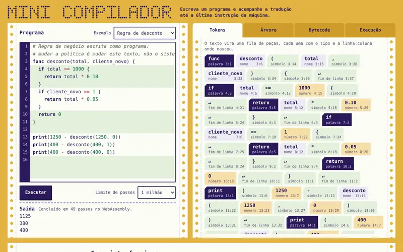

# Mini compilador: linguagem Linha



Um compilador de verdade para uma linguagem pequena, feito três vezes de propósito: em Python, em JavaScript e com a máquina virtual em C compilada para WebAssembly. O playground roda direto no navegador e mostra cada etapa, dos tokens até a execução instrução por instrução.

O projeto nasceu de uma calculadora acadêmica, que continua em `Compilador_Python/calculadora.py`.

## O que a linguagem faz

```text
# Números, variáveis, contas e comparações
total = 1250

func desconto(valor) {
  if valor >= 1000 {
    return valor * 0.10
  }
  return 0
}

i = 0
while i < 3 {
  print(total - desconto(total) + i)
  i = i + 1
}
```

- Números com ponto decimal, variáveis e os operadores `+ - * / %`.
- Comparações `== != < <= > >=`, que dão 1 ou 0. Em `if` e `while`, zero é falso e o resto é verdadeiro.
- `if`, `else`, `else if`, `while`, funções com recursão, `return` e `print`.
- Erros de sintaxe e de execução apontam linha e coluna.

## Como funciona

1. **Lexer:** separa o texto em tokens e guarda a posição de cada um.
2. **Parser recursivo:** confere a gramática e monta a árvore sintática (AST), com a precedência certa.
3. **Compilador:** percorre a árvore e gera bytecode em um formato binário único, descrito em `linha/bytecode.py`.
4. **Máquina de pilha:** executa o bytecode, com limite de passos contra laço infinito.

| Parte | Python | Navegador |
| --- | --- | --- |
| Lexer, parser e bytecode | `linha/` | `playground/compilador.mjs` |
| Máquina de pilha | `linha/maquina.py` | `c/vm.c` compilado em `playground/vm.wasm` |

O teste cruzado exige que os dois compiladores gerem exatamente os mesmos bytes e que as máquinas em Python, C nativo e WebAssembly deem a mesma saída, o mesmo erro e a mesma contagem de passos.

O módulo WebAssembly não tem nenhuma importação: ele não enxerga rede, arquivos nem a página. O código digitado nunca passa por `eval`, e a página tem uma política de segurança (CSP) que bloqueia terceiros.

## Como rodar

**Playground.** Sirva a raiz do repositório e abra o endereço no navegador. Não há etapa de build. No GitHub Pages, publique a raiz do ramo `main`.

```bash
python3 -m http.server 8000
```

**Linha de comando.** Precisa de Python 3.10 ou mais novo, sem dependências.

```bash
python3 -m linha executar programa.lin     # compila e executa
python3 -m linha tokens programa.lin       # mostra os tokens
python3 -m linha arvore programa.lin       # mostra a árvore
python3 -m linha bytecode programa.lin     # mostra o bytecode
python3 -m linha compilar programa.lin -o programa.lbc
python3 -m linha repl                      # modo interativo
```

**Máquina em C.** O script gera o `.wasm` com `clang --target=wasm32 -nostdlib` e `wasm-ld`, e os executáveis nativos com `gcc`.

```bash
c/compilar.sh                              # tudo
c/build/linha_vm programa.lbc
```

**Testes.**

```bash
python3 -m unittest discover -s testes -t .
NODE_PATH=$(npm root -g) node testes/navegador.cjs
```

A primeira linha roda os testes de unidade, o teste cruzado com os executáveis em C (um deles com `-fsanitize=address,undefined`) e o teste com bytecode corrompido. A segunda percorre o playground em computador e celular com Playwright e Chromium já instalados.

## Tecnologias

Python 3 (só biblioteca padrão), C11 sem libc na máquina virtual, WebAssembly, JavaScript em módulos, HTML, CSS e SVG, `unittest`, Playwright, AddressSanitizer e UBSan.

Desenvolvi este projeto e usei o Claude, da Anthropic, como ferramenta durante o desenvolvimento.
